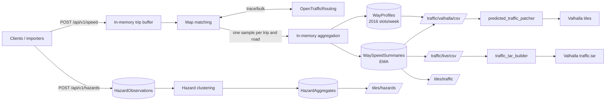

# OpenTrafficDB

OpenTrafficDB is a community traffic speed database. Contributors submit GPS speed observations and hazard reports through a REST API. The server map-matches the observations to OpenStreetMap ways, aggregates them into weekly speed profiles and live speeds, and publishes the results as CSV exports for the [Valhalla](https://github.com/valhalla/valhalla) routing engine, as Mapbox Vector Tiles, and through a traffic-aware routing API. The application is a single ASP.NET Core service backed by PostgreSQL/PostGIS and Redis.

## Features

- **Speed ingestion.** Single and batch submission of GPS speed observations (up to 100,000 per batch), with server-side validation of speed, GPS accuracy, coordinates and timestamp drift.
- **Hazard ingestion.** Reports for speed cameras, accidents, police activity, road works, traffic jams and other hazards (up to 10,000 per batch). Reports are clustered by location, heading and type, and expire per type (for example 30 days for cameras, 1 hour for police activity).
- **Server-side map matching.** Trips are split into segments, encoded as polylines and matched in bulk against the OpenTrafficRouting trace endpoint. Interpolated edges produce additional observations for ways between GPS points.
- **Aggregation.** Each OSM way gets 2,016 five-minute buckets per week, plus exponential moving averages for constrained and free-flow speed. Weekly profiles are DCT-II compressed into Valhalla's predicted speed format during aggregation.
- **Valhalla exports.** A predicted traffic CSV (`way_id,freeflow_speed,constrained_speed,historical_speeds`) and a live traffic CSV (`way_id,speed_kmh,freeflow_kmh`, last 60 minutes by default).
- **Vector tiles.** Traffic and hazard overlays as gzip-compressed MVT, built by PostGIS (`ST_AsMVT`) and cached in Redis for 15 seconds, so the traffic map stays near-live. TileJSON and MapLibre style documents are included.
- **Routing.** Traffic-enriched routing and day-profile travel time buckets, proxied to OpenTrafficRouting.
- **Accounts and API keys.** Email registration with verification, password reset, session login for the web UI and hashed API keys for machine access. Users are promoted to Contributor after a configurable number of accepted observations.
- **Abuse protection.** Per-IP and per-key rate limits for submissions, reads and registrations, plus an admin-managed IP block list.
- **Web UI.** Dashboard, profile and API key management, admin panel, live traffic map, routing map, an admin-only map that compares the traffic layer with TomTom flow side by side, and built-in documentation pages.
- **Operations.** Swagger UI, `/health` (PostgreSQL check) and a Prometheus `/metrics` endpoint via OpenTelemetry. Monthly partitions for raw observations are created automatically.

## Architecture

### Components

| Component | Image / runtime | Role |
| --- | --- | --- |
| `api` | ASP.NET Core on .NET 10 (`App/`) | REST API, web UI, background jobs |
| `postgres` | `postgis/postgis:17-3.5-alpine` | Primary data store, PostGIS geometry and MVT encoding |
| `pgbouncer` | `edoburu/pgbouncer` | Connection pooling in transaction mode |
| `redis` | `redis:7-alpine` | Distributed tile cache (falls back to in-memory cache if not configured) |
| OpenTrafficRouting | external service | Map matching (`/api/v1/trace/bulk`) and routing (`/api/v1/route`) |

The app also supports an optional read replica (`ConnectionStrings:ReadConnection`). Exports and tiles read from it; writes go to the primary.

### Background services

All jobs run in-process inside the `api` container:

| Service | Interval | Task |
| --- | --- | --- |
| `SpeedMatchingWorker` | continuous | Streams buffered trips to OpenTrafficRouting (up to 8 bulk requests in flight) and turns the results into one sample per trip and road |
| `SpeedAggregator` | every 10 s | Writes the samples to the weekly buckets and live summaries in two bulk upserts |
| `HazardAggregationService` | 30 s (configurable) | Clusters hazard reports and map-matches cluster centroids |
| `WayGeometryBackgroundService` | at startup, then every 30 days | Downloads the configured OSM PBF and imports road geometries for tiles |
| `PartitionMaintenanceService` | at startup, then daily | Creates monthly `SpeedObservations` partitions three months ahead (legacy table, no longer written) |
| `StatsHistoryService` | 15 s | Samples pipeline stats and keeps the last hour for the admin dashboard |

### Data flow



Raw observations never touch the database. Postgres only stores the results.

1. **Ingestion.** Clients submit observations with an API key. The API validates each record, hashes the trip ID together with the key ID, adds the points to an in-memory trip buffer and counts the contribution. The buffer is bounded (`Pipeline:MaxBufferedPoints`); when it is full, the API answers `503` with `Retry-After`.
2. **Map matching.** A trip is queued when it receives new points. Each trace segment is only matched onto OSM roads that fit it: if the observations carry `roadClass` (`motorway`, `trunk`, `primary`, `secondary`, `tertiary`, `local`), that class and its neighbours; otherwise the class is inferred from the median speed (fast traces exclude small roads). This keeps traces from snapping onto parallel roads of another class. The matching worker splits trips at gaps over 500 m or after 20 km and sends the polylines to OpenTrafficRouting, with up to `OpenTrafficRouting:MaxConcurrent` bulk requests in flight. Per trip and road, the matched points are averaged into one sample; roads crossed between two points (interpolated edges) get one sample each. Unmatched points are retried only together with new points of the same trip, and the last matched points stay as context, so a trip uploaded in parts is matched as one trace.
3. **Live aggregation.** Every 10 seconds the samples are written to the live summaries (EMA, alpha 0.8, and road class) in one bulk upsert. The traffic map and the live CSV read them.
4. **Weekly profiles and predictions.** Every 30 minutes each touched road's weekly profile (`WayProfiles`: 2,016 five-minute slots, average speed and capped count, one row per road) is updated. Profiles are stored as a bit stream of their filled slots (`WayProfileCodec`, ~235 bytes per road), so Postgres does not compress them. The Valhalla CSV export computes the predicted speeds per road from the profile and the current free-flow speed and encodes them (200 DCT-II coefficients). Each slot is blended with the free-flow speed for weeks without a sample; empty slots take the nearest slot with data within ±60 minutes. OpenTrafficRouting's predicted traffic uses this export.
5. **Restarts.** Points still in the buffer are lost on a restart (seconds of data). Pending samples are flushed on graceful shutdown.
6. **Output.** The CSV exports stream from the summaries. Tiles join the summaries and hazard aggregates with the imported way geometries. The C++ tools in `tools/` and the related Valhalla importer turn the CSVs into Valhalla data.

## API overview

The interactive OpenAPI documentation is available at `/swagger` on every instance. The built-in guides live under `/docs`.

### Authentication

Machine clients authenticate with API keys. There is no separate token exchange: the raw API key is the bearer token.

1. Register at `/Home/Register` (or `POST /auth/register`). The server sends a verification link to the email address.
2. Open the link (`GET /auth/verify?token=...`). The account becomes active.
3. Log in at `/Home/Login`. The web UI uses a session cookie (`otdb_session`, 12 hours sliding).
4. Create an API key on the profile page (`POST /web/me/keys`). The key is shown once. The server stores only its SHA-256 hash and an 8-character prefix.
5. Send the key with every API request:

   ```
   Authorization: Bearer <api-key>
   ```

Keys are accepted only if the key and its owner are active and the owner's email is verified. Roles are `User`, `Contributor` and `Admin`. A user becomes `Contributor` after `Security:ContributorThreshold` accepted observations (default 100). Email addresses are stored as SHA-256 hashes.

On first start, if no admin exists, the app creates `admin@example.com` with a random password and prints the credentials to the console. Change the password after the first login.

### Endpoints

**Ingestion** (API key required)

| Method | Path | Description |
| --- | --- | --- |
| `POST` | `/api/v1/speed` | Submit one speed observation |
| `POST` | `/api/v1/speed/batch` | Submit up to 100,000 speed observations |
| `POST` | `/api/v1/hazards` | Submit one hazard report |
| `POST` | `/api/v1/hazards/batch` | Submit up to 10,000 hazard reports |

**Traffic output**

| Method | Path | Auth | Description |
| --- | --- | --- | --- |
| `GET` | `/api/v1/traffic/valhalla/csv` | API key | Predicted traffic CSV in Valhalla format |
| `GET` | `/api/v1/traffic/live/csv` | API key | Live speeds of ways updated in the live window (default 60 minutes, `Traffic:LiveWindowMinutes`) |
| `GET` | `/api/v1/hazards/live/csv` | public | Active (non-expired) hazards |

**Vector tiles** (public, CORS enabled)

| Method | Path | Description |
| --- | --- | --- |
| `GET` | `/tiles/traffic/current/{z}/{x}/{y}` | Traffic overlay tile (layer `traffic`) |
| `GET` | `/tiles/traffic/current.json` | TileJSON for the traffic layer |
| `GET` | `/tiles/traffic/current/style.json` | MapLibre style for the traffic layer |
| `GET` | `/tiles/hazards/current/{z}/{x}/{y}` | Hazard overlay tile (layer `hazards`) |
| `GET` | `/tiles/hazards/current.json` | TileJSON for the hazard layer |
| `GET` | `/tiles/hazards/current/style.json` | MapLibre style for the hazard layer |

**Routing** (API key required, proxied to OpenTrafficRouting)

| Method | Path | Description |
| --- | --- | --- |
| `GET`, `POST` | `/api/v1/route` | Route with traffic enrichment. Body as JSON, or `?json=` for GET. `?raw=true` returns the unmodified upstream response. |
| `POST` | `/api/v1/route/buckets` | Predicted travel times across a day in buckets of 1 to 12 hours |

If traffic enrichment fails, `/api/v1/route` falls back to the raw route and sets `X-Traffic-Enrichment: failed`.

**Web endpoints** (session cookie, used by the web UI)

| Prefix | Description |
| --- | --- |
| `/auth/*` | Register, verify, login, logout, forgot and reset password |
| `/web/me*` | Profile, password and email change, API key management |
| `/web/route*` | Routing for the web map |
| `/web/admin/*` | Admin only: stats, users, roles, keys, IP blocks, traffic data purge |

**Operations**

| Path | Description |
| --- | --- |
| `/health` | Health check including PostgreSQL |
| `/metrics` | Prometheus metrics |
| `/swagger` | OpenAPI UI |

### Example

```bash
curl -X POST https://opentrafficdb.example.com/api/v1/speed \
  -H "Authorization: Bearer $OTDB_API_KEY" \
  -H "Content-Type: application/json" \
  -d '{
        "timestamp": "2026-01-01T12:00:00Z",
        "latitude": 51.2277,
        "longitude": 6.7735,
        "speedMs": 13.9,
        "heading": 90,
        "gpsAccuracyMeters": 5,
        "tripId": "b3c1e0d2-1f4a-4c55-9a3e-0d8f2f6a7c11"
      }'

curl -H "Authorization: Bearer $OTDB_API_KEY" \
  https://opentrafficdb.example.com/api/v1/traffic/live/csv -o live.csv
```

Timestamps must be within `Security:MaxTimestampDriftSeconds` (default 300 s) of server time. Rate-limited requests return `429`.

## Configuration

### Environment variables (Docker Compose)

Copy `.env.example` to `.env` and adjust the values. `docker-compose.yml` reads the following variables:

| Variable | Default | Description |
| --- | --- | --- |
| `POSTGRES_PASSWORD` | none | Password for the `opentraffic` database user |
| `REDIS_PASSWORD` | none | Redis password |
| `READ_DB_HOST` | `pgbouncer` | Host of an optional read replica |
| `IP_HASH_PEPPER` | none | Passed to the app as `Security:IpHashPepper` |
| `BASE_URL` | none | Public URL of the instance. Used in email links, TileJSON and style documents. |
| `OTR_BASE_URL` | none | Base URL of the OpenTrafficRouting service. Required for map matching and routing. |
| `VALHALLA_TILE_URL` | none | URL of the OSM PBF extract to download, for example a Geofabrik extract. Used to import way geometries for tiles. |
| `APP_PORT` | `8095` | Host port of the app |
| `PGBOUNCER_PORT` | `26432` | Host port of PgBouncer. Only needed for external database access. |
| `PG_SHARED_BUFFERS` | `1GB` | PostgreSQL `shared_buffers` |
| `PG_EFFECTIVE_CACHE_SIZE` | `2GB` | PostgreSQL `effective_cache_size` |
| `PG_WORK_MEM` | `16MB` | PostgreSQL `work_mem` |
| `PG_MAINTENANCE_WORK_MEM` | `256MB` | PostgreSQL `maintenance_work_mem` |
| `PG_WAL_BUFFERS` | `16MB` | PostgreSQL `wal_buffers` |
| `SMTP_HOST` | empty | SMTP server. If empty, emails are written to the log instead of sent. |
| `SMTP_PORT` | `25` | SMTP port |
| `SMTP_USER`, `SMTP_PASSWORD` | empty | SMTP credentials |
| `SMTP_SSL` | `false` | Enable TLS for SMTP |
| `SMTP_FROM`, `SMTP_FROM_NAME` | `opentrafficdb@localhost`, `OpenTrafficDB` | Sender address and name |
| `MAPTILER_API_KEY` | empty | MapTiler key for the base map style of the traffic, routing and debug maps |
| `TOMTOM_API_KEY` | empty | Optional. Enables the admin-only TomTom comparison map at `/map/debug/tomtom`. TomTom tiles are proxied by the server (key stays private), cached for 5 minutes, and count against the TomTom tile quota. |
| `APP_IMAGE` | `registry.gitlab.com/opentrafficdb/app:latest` | App image to run |

The PostgreSQL memory defaults fit a host with about 8 GB RAM shared with other services. Raise them on dedicated hosts.

### Application settings

The app reads `App/appsettings.json`. Override any key with an environment variable that uses `__` as separator, for example `Security__ContributorThreshold=50`.

| Key | Default | Description |
| --- | --- | --- |
| `ConnectionStrings:DefaultConnection` | local PostgreSQL | Primary database |
| `ConnectionStrings:ReadConnection` | primary | Read replica |
| `ConnectionStrings:Redis` | unset | Redis for the tile cache; in-memory cache if unset |
| `OpenTrafficRouting:BaseUrl` | `http://localhost:8002` | OpenTrafficRouting service |
| `OpenTrafficRouting:BatchSize` | `25` (compose: `200`) | Polylines per bulk trace request |
| `OpenTrafficRouting:MaxConcurrent` | `4` (compose: `8`) | Concurrent bulk trace requests |
| `Pipeline:MaxBufferedPoints` | `3000000` | Maximum points in the in-memory buffer; beyond it the API answers 503 with Retry-After |
| `Pipeline:FlushSeconds` | `10` | Interval of the bulk write of aggregated samples |
| `Pipeline:ProfileFlushMinutes` | `30` | Interval of the weekly-profile write (`WayProfiles`) |
| `Pipeline:ProfileCountCap` | `52` | Sample count cap per five-minute slot; beyond it the slot average acts as a moving average |
| `Pipeline:BatchLingerMs` | `100` | How long the matcher waits to fill a batch before sending a smaller one |
| `Pipeline:TripIdleSeconds` | `180` | Trips without new points are forgotten after this time (with their context) |
| `Pipeline:ContextPoints` | `3` | Last matched points kept per trip as context for the next upload |
| `OpenTrafficRouting:BatchSize` | `200` | Polylines per bulk trace request |
| `OpenTrafficRouting:MaxConcurrent` | `8` | Bulk trace requests in flight |
| `Traffic:TileCacheSeconds` | `15` | Redis cache time of traffic tiles |
| `Aggregation:MaxMatchAttempts` | `3` | Attempts before an unmatched observation is given up |
| `Aggregation:MatchRetryWindowSeconds` | `300` | Unmatched observations are retried with new points of the same trip within this window |
| `Aggregation:FinalizeIntervalSeconds` | `60` | Interval of the cleanup of old metrics and legacy rows |
| `Traffic:LiveWindowMinutes` | `60` | Age limit of live speeds in tiles and the live CSV. Keep it longer than the refresh cycle of your data sources. |
| `Traffic:TileMinDelay` | `0` | Minimum delay factor (0–1) for a road to appear in the traffic tiles. `0` shows all roads with data; `0.25` shows only slow traffic and jams. |
| `Hazards:AggregationIntervalSeconds` | `30` | Hazard clustering interval |
| `Hazards:ClusterGridMeters` | `30` | Cluster grid size |
| `Hazards:RematchDriftMeters` | `10` | Centroid drift that triggers re-matching |
| `Hazards:MaxObservationsPerCycle` | `5000` | Hazard reports per cycle |
| `Hazards:MatchSearchRadiusMeters` | `100` | Search radius for hazard map matching |
| `Osm:PbfUrl`, `Osm:PbfPath` | unset, `/data/map.osm.pbf` | OSM extract source and local path |
| `Security:MaxSpeedMs` | `111.11` | Maximum accepted speed (400 km/h) |
| `Security:MaxGpsAccuracyMeters` | `25` | Reject observations with worse accuracy |
| `Security:WarnGpsAccuracyMeters` | `50` | Return a warning above this accuracy |
| `Security:MaxTimestampDriftSeconds` | `300` | Maximum difference from server time |
| `Security:MaxHazardMetadataLength` | `2048` | Maximum length of hazard metadata JSON |
| `Security:SubmitRateLimitPerMinutePerIp` / `PerKey` | `120` / `200` | Submission rate limits |
| `Security:ReadRateLimitPerMinutePerIp` / `PerKey` | `30` / `60` | Read and export rate limits |
| `Security:RegisterRateLimitPerHourPerIp` | `5` | Registration rate limit |
| `Security:ContributorThreshold` | `100` | Accepted observations for promotion to Contributor |
| `MapTiler:ApiKey` | empty | MapTiler key for the web maps |
| `BaseUrl` | `http://localhost:5015` | Public URL |
| `Email:*` | see file | SMTP settings |

## Running with Docker Compose

Requirements:

- Docker with the Compose plugin
- A reachable OpenTrafficRouting instance
- Host directories for persistent data: `/mnt/opentraffic/postgres`, `/mnt/opentraffic/redis` and `/mnt/opentraffic/osm`

Steps:

```bash
# 1. Create data directories
sudo mkdir -p /mnt/opentraffic/postgres /mnt/opentraffic/redis /mnt/opentraffic/osm

# 2. Configure
cp .env.example .env
# Edit .env: set passwords, BASE_URL, VALHALLA_TILE_URL, MAPTILER_API_KEY
# and OTR_BASE_URL

# 3. Build the app image
docker build -f App/Dockerfile -t opentrafficdb-app:local .
echo "APP_IMAGE=opentrafficdb-app:local" >> .env

# 4. Start
docker compose up -d

# 5. Read the generated admin password
docker compose logs api | grep -A4 "DEFAULT ADMIN"
```

The app applies database migrations on startup. On the first start it downloads the OSM extract from `VALHALLA_TILE_URL` and imports road geometries; tiles stay empty until the import completes.

The web UI is available at `http://localhost:${APP_PORT}`. Put a reverse proxy with TLS in front of it for public deployments. The app honors `X-Forwarded-For` and `X-Forwarded-Proto`.

The compose file publishes PostgreSQL (host port `45432`), PgBouncer (`PGBOUNCER_PORT`) and Redis (`6379`) on all interfaces. Remove these port mappings or restrict them with a firewall if you do not need external access.

The download links for the tool binaries on the `/docs/live-traffic` and `/docs/predicted-traffic` pages point to `/downloads/`. The CI pipeline copies the compiled tools into `App/wwwroot/downloads` before building the image. For a local build, copy them there yourself (see [Tools](#tools)).

## Local development

Requirements: .NET 10 SDK and Docker.

```bash
# Start a local PostgreSQL on 127.0.0.1:5432
docker compose -f docker-compose.dev.yml up -d

# Run the app on http://localhost:5015
cd App
dotnet run
```

The default connection string in `appsettings.json` matches the dev database (`opentraffic` / `changeme`). Override it with the environment variable `ConnectionStrings__DefaultConnection` or with `dotnet user-secrets`. Without Redis, the app uses an in-memory cache. Without `Email:SmtpHost`, verification and reset emails appear in the log, so you can complete registration locally.

The initial migration enables the `postgis` extension. `docker-compose.dev.yml` uses `postgres:17-alpine`, which does not ship PostGIS. Use `postgis/postgis:17-3.5-alpine` instead if the migration fails.

Map matching, routing and tile content require `OpenTrafficRouting:BaseUrl` and `Osm:PbfUrl`. Ingestion, accounts and the web UI work without them.

Add a migration:

```bash
cd App
dotnet ef migrations add <Name>
```

## Tools

`tools/` contains two standalone C++17 programs without external dependencies. Both need a Valhalla tile extract and a `way_edges.txt` file from `valhalla_ways_to_edges`.

Build:

```bash
cd tools/traffic-tar-builder && make
cd tools/predicted-traffic-patcher && make
```

The CI pipeline builds static Linux binaries with `make CXX=g++ CXXFLAGS="-std=c++17 -O2 -Wall -Wextra -static"`.

### traffic_tar_builder

Builds a Valhalla `traffic.tar` with live speeds from `/api/v1/traffic/live/csv`.

```bash
valhalla_ways_to_edges --config valhalla.json way_edges.txt
curl -H "Authorization: Bearer $OTDB_API_KEY" \
  https://opentrafficdb.example.com/api/v1/traffic/live/csv -o live.csv
./traffic_tar_builder --tiles valhalla_tiles.tar --csv live.csv \
  --way-edges way_edges.txt -o traffic.tar
```

### predicted_traffic_patcher

Patches the `.gph` tiles in a Valhalla tile extract with predicted traffic from `/api/v1/traffic/valhalla/csv`. For each matching directed edge it sets the free-flow and constrained speeds and appends the compressed weekly speed profile.

```bash
curl -H "Authorization: Bearer $OTDB_API_KEY" \
  https://opentrafficdb.example.com/api/v1/traffic/valhalla/csv -o predicted.csv
./predicted_traffic_patcher --tiles valhalla_tiles.tar --csv predicted.csv \
  --way-edges way_edges.txt -o valhalla_tiles_patched.tar
```

## Continuous integration

`.gitlab-ci.yml` defines three stages:

1. `tools`: builds both tools as static Linux binaries and packages their sources.
2. `build`: copies the tools into `App/wwwroot/downloads`, builds the Docker image and pushes it tagged with the commit SHA, the branch name and `latest` (on `main`).
3. `deploy`: on `main`, pulls the images and runs `docker compose up -d` on the deployment runner.

## Project layout

```
App/                       ASP.NET Core application
  Controllers/             REST API, web endpoints, docs and map pages
  Services/                Map matching, aggregation, tiles, routing, auth, email
  Data/                    EF Core context and partition maintenance
  Models/                  Entities and DTOs
  Migrations/              EF Core migrations
  Views/                   Razor views: web UI, maps, docs
  Dockerfile
tools/
  traffic-tar-builder/     Live traffic -> Valhalla traffic.tar
  predicted-traffic-patcher/  Predicted traffic -> Valhalla graph tiles
docker-compose.yml         Production stack
docker-compose.dev.yml     Local PostgreSQL
.env.example               Configuration template
```

## Related projects

- [opentrafficdb_valhalla_importer](https://github.com/mKenfenheuer/opentrafficdb_valhalla_importer): C++ tool that pulls traffic from the OpenTrafficDB API and writes it into Valhalla traffic tiles.
- OpenTrafficRouting: routing and map-matching service used by OpenTrafficDB, configured via `OpenTrafficRouting__BaseUrl`.

## License

The source code is licensed under the MIT License. Copyright (c) Maximilian Kenfenheuer. See [LICENSE](LICENSE).

Traffic data served by an OpenTrafficDB instance is not covered by the code license. The app ships a separate data license page at `/Home/License`; operators define the terms for their instance's data.
